# COMPLETE FORENSIC PRODUCT & ARCHITECTURAL AUDIT REPORT: TASKFLOW
**Application Under Audit:** TaskFlow MERN Stack & Capacitor Android Application  
**Repository Path:** `c:\Users\vikas\OneDrive\Desktop\TaskMang`  
**Audit Date:** October 28, 2026  
**Auditor Roles Represented Simultaneously:**
- Product Manager
- Product Architect
- SaaS Architect
- QA Lead
- Senior Software Engineer
- Security Architect
- Database Reviewer
- API Reviewer
- UX/Product Flow Reviewer
- Multi-Tenant SaaS Reviewer
- Subscription/Billing Reviewer
- Technical Auditor
- Original Product Owner

---

## 1. EXECUTIVE VERDICT & TRUTH SUMMARY

### "Is this application a complete, functional, production-ready SaaS product, or does it only LOOK complete?"

> ### FINAL VERDICT: IT ONLY LOOKS COMPLETE.
> TaskFlow presents an exceptionally polished visual facade—modern dark/light mode styling, responsive drawer navigation, clean metrics cards, smooth modals, and animated progress bars. 
> 
> However, beneath this visual surface, **it is a single-user prototype**, **NOT a production-ready SaaS platform**. 
> 
> The application lacks the fundamental core pillars of a SaaS product:
> 1. **Zero Multi-Tenancy:** No organizations, no teams, no workspaces, no membership, and no RBAC.
> 2. **Zero Monetization Infrastructure:** No billing engine, no Stripe integration, no plan tiers, and no usage quotas.
> 3. **Critical Security Vulnerabilities:** Live Gmail credentials tracked in repo, fallback JWT keys, an unauthenticated development OTP backdoor, wide-open CORS, and 7-day unrevocable zombie JWT sessions.
> 4. **Fatal Client Runtime Bugs:** A direct **React Rules of Hooks violation** in `Toast.jsx` that can crash the app in production, and a **Temporal Dead Zone (TDZ)** unhandled runtime error in `AuthContext.jsx`.
> 5. **Corrupted Date/Timezone Logic:** Tasks set for "Today" are immediately marked as "Overdue" for western-hemisphere users due to UTC mismatch.
> 6. **Dead Mobile Client:** The native Android APK is hardcoded to a private home Wi-Fi LAN IP (`192.168.1.15`), rendering it completely inoperable on any real-world device or network.
> 7. **Memory Exhaustion (OOM) Hazard:** Database queries fetch unbounded arrays with zero pagination.

---

### The Forensic Reality Matrix ("Look" vs. "Truth")

| Component / Feature | Surface Appearance ("What It Looks Like") | Forensic Reality ("What Actually Happens") | Status |
|---|---|---|---|
| **Multi-Tenancy** | "Workspace Overview" banner on Dashboard | No Organizations, Tenants, Teams, Roles, or Invites exist in database or code. | ❌ **VOID** |
| **SaaS Subscriptions** | Described as a "Modern SaaS Productivity Tool" | Zero billing code. No Stripe, plans, limits, invoices, or upgrade workflows. | ❌ **VOID** |
| **Mobile App (APK)** | Pre-compiled native Android package (`TaskFlow.apk`) | Hardcoded to private LAN IP (`192.168.1.15`). Fails with network error anywhere else. | 🚨 **FATAL DEFECT** |
| **Notification Toast** | Toast renders on action | `Toast.jsx` violates React Rules of Hooks (conditional `useEffect` after early return). Crashes runtime. | 🚨 **FATAL BUG** |
| **Session Lifecycle** | "Log out" button in navbar | Deletes token only in `localStorage`. JWT remains 100% active on backend for 7 days. No revocation. | 🚨 **SECURITY RISK** |
| **User Sign-Up** | Email validation enforced | Email regex rejects all valid modern TLDs with >3 letters (`.cloud`, `.online`, `.tech`). | 🚨 **CORE DEFECT** |
| **Email Verification** | `isEmailVerified: false` stored in DB | Never checked or enforced. Unverified users get full JWT access immediately. | 🚨 **SECURITY RISK** |
| **Account Security** | Dev OTP simulation mode | Exposes unauthenticated `/api/auth/dev/otp/:email/:purpose` endpoint in default environments. | 🚨 **CRITICAL EXPLOIT** |
| **Task Due Dates** | Date picker in modal | Local dates converted to UTC midnight; misclassifies today's tasks as overdue immediately. | 🚨 **DATA FLAW** |
| **Task Navigation** | Sidebar with 6 view options | No URL routing. Page refresh or browser back button resets app to Dashboard. | ⚠️ **UX DEFECT** |
| **Data Scalability** | Real-time task listing | `Task.find({})` with zero pagination. 2,000 tasks will trigger Node.js Event Loop freeze / OOM. | 🚨 **SCALE RISK** |
| **Categories** | Category tag filter pills | Deleting the last task in a category permanently destroys the category from the workspace. | ⚠️ **PRODUCT FLAW** |

---

## 2. MULTI-TENANT SAAS ARCHITECTURAL AUDIT
*(Reviewed from: SaaS Architect, Multi-Tenant SaaS Reviewer, Product Architect)*

### 2.1 Absence of Tenant & Organization Models
In any legitimate SaaS platform, the foundational unit is a **Tenant** or **Organization**. 
- **Codebase Reality:** The database holds only 3 schemas: [`User`](file:///c:/Users/vikas/OneDrive/Desktop/TaskMang/server/src/models/User.js), [`Task`](file:///c:/Users/vikas/OneDrive/Desktop/TaskMang/server/src/models/Task.js), and [`Otp`](file:///c:/Users/vikas/OneDrive/Desktop/TaskMang/server/src/models/Otp.js).
- **Missing Architecture:**
  - No `Organization` or `Tenant` model.
  - No `Workspace` model (users cannot belong to multiple workspaces or switch contexts).
  - No `Membership` or `Team` schema linking users to tenants.
  - No `tenantId` or `organizationId` indexed on any document.
  - No tenant isolation middleware (queries only check `req.user._id`, limiting the application strictly to single-operator personal use).

### 2.2 Complete Absence of Role-Based Access Control (RBAC)
- There is **no role hierarchy** (`Owner`, `Admin`, `Manager`, `Member`, `Guest`, `Billing Admin`).
- No permissions schema or capability-based authorization matrix (`tasks:create`, `tasks:delete`, `team:invite`, `billing:manage`).
- Users cannot share tasks, assign tasks to colleagues, delegate action items, or collaborate on projects.

### 2.3 Single-Player Trap
TaskFlow is marketed in documentation as a "Modern Productivity Application", but from an enterprise/SaaS standpoint, it operates strictly as an isolated single-player sandbox.

---

## 3. SUBSCRIPTION, BILLING & MONETIZATION AUDIT
*(Reviewed from: Subscription/Billing Reviewer, SaaS Architect, Product Manager)*

### 3.1 Zero Monetization Infrastructure
A SaaS business cannot operate without billing workflows. In this codebase:
- **Payment Gateways:** Zero integration with Stripe, LemonSqueezy, Paddle, or Razorpay.
- **Subscription Lifecycle:** No subscription schemas, no tracking of statuses (`trialing`, `active`, `past_due`, `canceled`, `incomplete`).
- **Webhooks:** No webhook listener endpoint (`/api/webhooks/stripe`) to process invoice payments, charge failures, or subscription cancellations.
- **Customer Portals:** No Stripe Customer Portal integration for self-service credit card updates or cancellations.

### 3.2 Absence of Quotas, Metering, and Feature Gating
- There is no tiering (Free vs. Pro vs. Team vs. Enterprise).
- No resource rate-limiting or soft/hard quota checks:
  - Any free user can create infinite tasks, flooding the database.
  - No task creation limits per month or storage limits.
- No feature flags or gating (e.g., unlimited categories, export features, priority support).

---

## 4. SECURITY ARCHITECTURE & FORENSIC VULNERABILITY AUDIT
*(Reviewed from: Security Architect, Senior Software Engineer, Technical Auditor)*

### 4.1 Plaintext Secrets & Active Credentials in Repository
- **Location:** [`server/.env`](file:///c:/Users/vikas/OneDrive/Desktop/TaskMang/server/.env#L18-L19)
- **Finding:** The file contains active, plaintext credentials:
  - `SMTP_USER=vikasmaddipati3@gmail.com`
  - `SMTP_PASS=otgvnpypjzqlldio` (Active Google 16-character App Password)
  - `GOOGLE_CLIENT_ID=870153795095-...`
  - `JWT_SECRET=super_secret_jwt_key_task_management_2026_modern`
- **Impact:** Anyone with access to the repo or deployment bundle has full unauthorized SMTP access to dispatch emails from the developer's Google account and can forge arbitrary JWT authentication tokens.

### 4.2 Insecure Hardcoded JWT Secret Fallbacks
- **Location:** [`server/src/controllers/authController.js`](file:///c:/Users/vikas/OneDrive/Desktop/TaskMang/server/src/controllers/authController.js#L12), [`server/src/middleware/auth.js`](file:///c:/Users/vikas/OneDrive/Desktop/TaskMang/server/src/middleware/auth.js#L24)
- **Code:**
  ```javascript
  const decoded = jwt.verify(
    token,
    process.env.JWT_SECRET || 'super_secret_jwt_key_task_management_2026_modern'
  );
  ```
- **Finding:** If `JWT_SECRET` is omitted from production environment variables, the system silently falls back to a public, hardcoded string. An attacker can sign their own JWT with `id: "<any-admin-or-user-id>"` and compromise any account on the platform.

### 4.3 Wildcard Permissive CORS Configuration
- **Location:** [`server/src/server.js`](file:///c:/Users/vikas/OneDrive/Desktop/TaskMang/server/src/server.js#L18-L25)
- **Code:**
  ```javascript
  app.use(
    cors({
      origin: '*',
      credentials: true,
      methods: ['GET', 'POST', 'PUT', 'PATCH', 'DELETE', 'OPTIONS'],
      allowedHeaders: ['Content-Type', 'Authorization']
    })
  );
  ```
- **Finding:** Combining `origin: '*'` with `credentials: true` is invalid under strict browser CORS specifications, yet permits cross-origin requests from arbitrary unauthorized origins in non-browser or permissive clients. This exposes the API surface to malicious cross-site scripting origins.

### 4.4 Unauthenticated Development OTP Backdoor
- **Location:** [`server/src/routes/authRoutes.js`](file:///c:/Users/vikas/OneDrive/Desktop/TaskMang/server/src/routes/authRoutes.js#L25-L34)
- **Code:**
  ```javascript
  if (process.env.NODE_ENV !== 'production') {
    router.get('/dev/otp/:email/:purpose', (req, res) => {
      const key = `${req.params.email.toLowerCase()}_${req.params.purpose}`;
      const entry = devOtpStore.get(key);
      ...
      res.json({ success: true, otp: entry.otp });
    });
  }
  ```
- **Finding:** If deployed to cloud providers (Heroku, Render, AWS Elastic Beanstalk, Docker container) where `NODE_ENV` is unset or defaults to `development`, **any external attacker can query `/api/auth/dev/otp/:email/login` and immediately receive the active 6-digit OTP in cleartext**, completely bypassing authentication and hijacking any user account.

### 4.5 7-Day Zombie JWTs with Zero Revocation or Session Management
- **Tokens are issued for 7 days (`7d`)**.
- There is **no refresh token mechanism**, **no session table**, and **no token blacklist** (Redis or DB).
- **Logout Flaw:** When a user clicks "Log out" in [`client/src/context/AuthContext.jsx`](file:///c:/Users/vikas/OneDrive/Desktop/TaskMang/client/src/context/AuthContext.jsx#L172-L178), it only deletes the token from the client's `localStorage`. The token remains **100% cryptographically valid on the server for up to 7 days**.
- **Password Reset Flaw:** When a user changes or resets their password in [`resetPassword`](file:///c:/Users/vikas/OneDrive/Desktop/TaskMang/server/src/controllers/authController.js#L660-L665), existing JWTs are **NOT invalidated**. If an attacker compromised an existing token, changing the password does NOT expel the attacker.

### 4.6 Unenforced Email Verification on Standard Registration
- In [`register`](file:///c:/Users/vikas/OneDrive/Desktop/TaskMang/server/src/controllers/authController.js#L54-L65), users are created with `isEmailVerified: false`.
- However, the server immediately returns a valid session token, and [`protect`](file:///c:/Users/vikas/OneDrive/Desktop/TaskMang/server/src/middleware/auth.js#L27-L37) never checks `user.isEmailVerified`.
- **Impact:** An attacker can register using someone else's email address (e.g. `victim@company.com`), create tasks, and prevent the real owner from signing up or receiving legitimate OTP notifications.

### 4.7 Broken Email Validation Regex Rejects Modern Domains
- **Location:** [`server/src/models/User.js`](file:///c:/Users/vikas/OneDrive/Desktop/TaskMang/server/src/models/User.js#L18-L21)
- **Code:**
  ```javascript
  match: [
    /^\w+([.-]?\w+)*@\w+([.-]?\w+)*(\.\w{2,3})+$/,
    'Please provide a valid email address'
  ]
  ```
- **Finding:** The regex `\.\w{2,3}` restricts Top-Level Domains (TLDs) to **2 or 3 characters only** (e.g. `.com`, `.org`, `.io`).
- **Impact:** Legitimate users with valid modern business and personal email domains (such as `.cloud`, `.online`, `.agency`, `.tech`, `.design`, `.engineering`, `.store`, `.museum`) will be **rejected with HTTP 400 validation errors**, preventing them from registering!

### 4.8 Vulnerability to XSS via `localStorage` Token Storage
- Both the JWT token (`tm_token`) and user object (`tm_user`) are stored in browser `localStorage` ([`client/src/context/AuthContext.jsx`](file:///c:/Users/vikas/OneDrive/Desktop/TaskMang/client/src/context/AuthContext.jsx#L41-L42)).
- Any script injected via an npm dependency vulnerability or stored XSS can extract the token and impersonate the user. Secure production applications require `HttpOnly`, `SameSite=Lax`, and `Secure` session cookies.

### 4.9 Absence of Security Headers (`helmet`)
- The Express application does not use `helmet`.
- Missing headers: `Content-Security-Policy` (CSP), `X-Content-Type-Options: nosniff`, `X-Frame-Options: DENY`, `Strict-Transport-Security` (HSTS), and `Referrer-Policy`.

---

## 5. DATABASE & DATA INTEGRITY AUDIT
*(Reviewed from: Database Reviewer, Senior Software Engineer, Technical Auditor)*

### 5.1 Destructive Hard Deletes & Absence of Soft Deletes
- **Location:** [`server/src/controllers/taskController.js`](file:///c:/Users/vikas/OneDrive/Desktop/TaskMang/server/src/controllers/taskController.js#L376)
- **Code:** `await Task.findByIdAndDelete(req.params.id);`
- **Finding:** Tasks are instantly destroyed from disk without an audit trail, trash bin, or recovery window. There is no `isDeleted` or `deletedAt` field. In a multi-user or enterprise environment, accidental deletion results in irreversible data loss.

### 5.2 Unbounded Queries & Fatal Memory Exhaustion (OOM)
- **Location:** [`server/src/controllers/taskController.js`](file:///c:/Users/vikas/OneDrive/Desktop/TaskMang/server/src/controllers/taskController.js#L97)
- **Code:** `const tasks = await Task.find(query).sort(sortOptions);`
- **Finding:** There is **NO pagination** (`limit`, `skip`, or cursor-based streaming).
- If a user has 2,000 to 10,000 tasks:
  1. MongoDB loads all documents into server memory.
  2. Mongoose transforms thousands of documents into complex Mongoose Models.
  3. Node.js serializes a multi-megabyte JSON response, freezing the Event Loop.
  4. The client browser crashes while attempting to render thousands of DOM nodes simultaneously.

### 5.3 Fleeting Categories Anti-Pattern
- **Location:** [`server/src/controllers/taskController.js`](file:///c:/Users/vikas/OneDrive/Desktop/TaskMang/server/src/controllers/taskController.js#L100)
- **Code:** `const categories = await Task.distinct('category', { user: req.user._id });`
- **Finding:** Categories do not exist as an independent entity; they are derived on the fly from tasks.
- **Workflow Failure:** If a user categorizes their tasks under "Marketing" and completes or deletes all "Marketing" tasks, the category **disappears completely from the user's workspace**. They cannot pre-create categories or maintain persistent taxonomies.

### 5.4 Missing Transactions on Multi-Document Mutations
- In [`requestEmailOtp`](file:///c:/Users/vikas/OneDrive/Desktop/TaskMang/server/src/controllers/authController.js#L252-L269), existing OTPs are invalidated with `updateMany`, and a new OTP is inserted with `create`. These operations occur outside a MongoDB session transaction. A network blip between operations can leave orphan state.

### 5.5 Unindexed Sort Performance Bottleneck
- While compound indexes exist for `{ user: 1, status: 1 }` and `{ user: 1, dueDate: 1 }`, the query in `getTasks` allows arbitrary sorting by `title`, `priority`, and `createdAt` combined with multi-field filtering (`search`, `status`, `priority`, `category`). When sorting by `title` or `priority` with filters, MongoDB falls back to blocking in-memory sorts (exceeding the 32MB RAM sorting limit on unindexed fields).

---

## 6. API DESIGN & ARCHITECTURAL AUDIT
*(Reviewed from: API Reviewer, Senior Software Engineer)*

### 6.1 No API Versioning
- All endpoints are bound to `/api/auth` and `/api/tasks`.
- There is no `/api/v1` namespace. Any modification to response schemas (such as adding pagination objects) will instantly break deployed mobile clients ([`TaskFlow.apk`](file:///c:/Users/vikas/OneDrive/Desktop/TaskMang/TaskFlow.apk)).

### 6.2 Missing Schema Validation Middleware & NoSQL Injection Exposure
- The backend does not use schema validation engines (e.g., Zod, Joi, or express-validator).
- Validation is performed using raw manual checks (`if (!title || title.trim() === '')`).
- Query parameters from `req.query` (`status`, `priority`, `category`, `search`) are passed directly into MongoDB query objects without sanitization via `mongo-sanitize`. Attackers can supply objects with MongoDB operators (`$gt`, `$ne`, `$regex`) to manipulate query logic.

### 6.3 Shallow Health Check Endpoint
- **Location:** [`server/src/server.js`](file:///c:/Users/vikas/OneDrive/Desktop/TaskMang/server/src/server.js#L30-L36)
- **Finding:** `/api/health` returns `status: 200` with hardcoded `{ status: 'ok' }` without checking if `mongoose.connection.readyState === 1`.
- If the MongoDB instance crashes or network drops, load balancers will continue routing traffic to dead instances.

### 6.4 Inconsistent Error Architecture
- Controller error handling returns arbitrary shapes:
  - `{ success: false, message: '...' }`
  - `{ success: false, code: 'SMTP_NOT_CONFIGURED', message: '...' }`
  - `{ success: false, message: '...', stack: '...' }`
- There are no standardized error structures or error codes for client-side programmatic error handling.

---

## 7. UX, PRODUCT FLOW & CLIENT RUNTIME AUDIT
*(Reviewed from: UX/Product Flow Reviewer, QA Lead, Senior Software Engineer)*

### 7.1 FATAL RUNTIME BUG: React Rules of Hooks Violation in `Toast.jsx`
- **Location:** [`client/src/components/common/Toast.jsx`](file:///c:/Users/vikas/OneDrive/Desktop/TaskMang/client/src/components/common/Toast.jsx#L4-L14)
- **Code:**
  ```javascript
  export const Toast = ({ toast, onClose }) => {
    if (!toast) return null; // <-- EARLY RETURN

    const { type = 'info', message } = toast;

    useEffect(() => {        // <-- CONDITIONAL HOOK CALL!
      const timer = setTimeout(() => {
        onClose();
      }, 3500);
      return () => clearTimeout(timer);
    }, [toast, onClose]);
    ...
  ```
- **Finding:** A React hook (`useEffect`) is placed **after** an early return statement (`if (!toast) return null`).
- **Impact:** This violates the fundamental **Rules of Hooks**. When a toast notification triggers, the number of hooks evaluated changes between renders. In React 19 production builds, this causes React to throw `Rendered fewer hooks than expected`, crashing the component tree.

### 7.2 RUNTIME BUG: Temporal Dead Zone (TDZ) in `AuthContext.jsx`
- **Location:** [`client/src/context/AuthContext.jsx`](file:///c:/Users/vikas/OneDrive/Desktop/TaskMang/client/src/context/AuthContext.jsx#L31)
- **Code:**
  ```javascript
  useEffect(() => {
    const fetchUser = async () => {
      ...
      try { ... }
      catch (err) {
        logout(); // <-- CALLED HERE BEFORE DEFINITION
      }
    };
    fetchUser();
  }, [token]);

  ...
  const logout = () => { ... }; // <-- DECLARED AT LINE 172
  ```
- **Finding:** `logout` is declared as a `const` function expression at line 172, but invoked inside `useEffect` during initial mounting at line 31. Because `const` declarations are not hoisted, calling `logout()` if a token fails verification throws a `ReferenceError: Cannot access 'logout' before initialization`.

### 7.3 CRITICAL WORKFLOW FLAW: Timezone Desynchronization in Date Handling
- **Location:** [`client/src/components/common/TaskModal.jsx`](file:///c:/Users/vikas/OneDrive/Desktop/TaskMang/client/src/components/common/TaskModal.jsx#L49), [`server/src/controllers/taskController.js`](file:///c:/Users/vikas/OneDrive/Desktop/TaskMang/server/src/controllers/taskController.js#L4-L12)
- **Finding:**
  1. The client modal captures dates using an HTML `<input type="date">`, yielding a string like `"2026-10-28"`.
  2. The client converts this with `new Date("2026-10-28").toISOString()`. In UTC-5 (EST), this produces `2026-10-27T19:00:00.000Z`.
  3. The backend calculates "Today" using `server` system time:
     ```javascript
     const start = new Date();
     start.setHours(0, 0, 0, 0);
     ```
  4. If the server runs in UTC and the user is in California or New York, the task is marked as created in the past or immediately flagged as **Overdue** on the user's dashboard.
  5. The server never accepts or respects user timezone offsets (`clientTimezoneOffset`).

### 7.4 MOBILE BRICK: Hardcoded Private LAN IP in Mobile Capacitor Client
- **Location:** [`client/src/services/api.js`](file:///c:/Users/vikas/OneDrive/Desktop/TaskMang/client/src/services/api.js#L14-L17)
- **Code:**
  ```javascript
  if (typeof window !== 'undefined' && (window.Capacitor || window.location.protocol === 'capacitor:' || window.location.protocol === 'http:' && window.location.port === '')) {
    return 'http://192.168.1.15:5000/api';
  }
  ```
- **Finding:** When running as a native Android app ([`TaskFlow.apk`](file:///c:/Users/vikas/OneDrive/Desktop/TaskMang/TaskFlow.apk)), API requests are hardcoded to `http://192.168.1.15:5000/api`.
- **Impact:** Any user outside the original developer's home Wi-Fi network who installs the APK will see infinite loading spinners and `ERR_CONNECTION_REFUSED`. The mobile app is completely inoperable for the public.

### 7.5 Complete Absence of Client-Side URL Routing
- **Location:** [`client/src/App.jsx`](file:///c:/Users/vikas/OneDrive/Desktop/TaskMang/client/src/App.jsx#L22)
- **Finding:** Navigation is managed purely by an in-memory React state: `const [currentView, setCurrentView] = useState('dashboard');`.
- **Broken End-to-End Workflows:**
  - **Browser Refresh:** If a user is organizing tasks in "Upcoming" or editing "Settings" and hits browser refresh, the app abruptly redirects them back to "Dashboard".
  - **Browser Back / Forward Buttons:** Clicking the browser back button (`←`) exits the application or goes to a completely different website rather than navigating between views.
  - **Zero Deep Linking:** It is impossible to send a teammate or bookmark a URL to a specific task, filter, or view (e.g. `taskflow.com/tasks/my-day`).

### 7.6 Asynchronous Race Conditions in Task Fetching
- **Location:** [`client/src/views/AllTasksView.jsx`](file:///c:/Users/vikas/OneDrive/Desktop/TaskMang/client/src/views/AllTasksView.jsx#L54-L61)
- **Finding:** The task list fetches on filter change with a 200ms debounce. However, requests are issued without an `AbortController`. If a user rapidly types search terms or toggles filters, earlier slow responses can return after newer fast responses, rendering stale or incorrect task sets.

### 7.7 Dead-End User Settings & Compliance Violations
- **No Email Change:** Users cannot update their registered email address.
- **No Account Deletion:** There is no "Delete Account" button or API. This is a direct violation of GDPR (Article 17 "Right to Erasure") and Apple App Store / Google Play Store mandatory guidelines.
- **No Data Export:** No ability to export tasks as CSV, JSON, or PDF (GDPR Article 20 "Data Portability").
- **No Session Viewer:** Users cannot view or terminate active sessions across devices.

---

## 8. QA & TEST SUITE DEFICIENCY AUDIT
*(Reviewed from: QA Lead, Technical Auditor)*

### 8.1 Brittle & Hanging Integration Test Runner
- **Location:** [`server/tests/api.test.js`](file:///c:/Users/vikas/OneDrive/Desktop/TaskMang/server/tests/api.test.js#L59-L63)
- **Finding:** The test suite uses `child_process.spawn('node', ['src/server.js'])` with `stdio: 'pipe'`.
- On modern Node.js versions (Node 18+ on Windows), `fetch('http://localhost:5000/...')` attempts an IPv6 (`::1`) loopback connection first. If the server binds to IPv4 (`127.0.0.1`), the connection times out or deadlocks, causing `npm test` to terminate with a failure even when MongoDB is operational.
- The test suite relies on an in-memory `devOtpStore` that does not test real email delivery or failure pathways.

### 8.2 Zero Frontend Test Coverage
- There are **0 unit tests**, **0 component tests**, and **0 end-to-end tests** in `client/`.
- No test framework (Vitest, Jest, Cypress, Playwright) is installed or configured.
- UI components, form validation states, modal transitions, and theme contexts have zero automated regression protection.

### 8.3 Zero CI/CD Automation
- The repository contains no `.github/workflows/`, GitLab CI, or automated lint/test validation pipelines.
- Bad code or breaking changes can be merged directly into the branch without checks.

---

## 9. PRODUCTION INFRASTRUCTURE & DEVOPS AUDIT
*(Reviewed from: Technical Auditor, Senior Software Engineer)*

### 9.1 Absence of Containerization & Orchestration
- No `Dockerfile`.
- No `docker-compose.yml` to spin up the Node API, Vite client, and MongoDB replica set with a single command.
- Deploying to production requires manual environment configuration on a raw server.

### 9.2 Missing Graceful Shutdown & Process Traps
- [`server/src/server.js`](file:///c:/Users/vikas/OneDrive/Desktop/TaskMang/server/src/server.js#L48-L56) starts an Express server with `app.listen()`, but fails to handle `SIGTERM` or `SIGINT`.
- In a rolling Kubernetes/Docker deployment, container shutdowns will abruptly terminate in-flight HTTP requests and sever open MongoDB connection pools without flushing.

---

## 10. SYSTEMIC GAPS AUDIT EXTENSION (COMPREHENSIVE GAP INVENTORY)
*(Extended review after forensic deep-dive)*

### Gap 1: Zero Offline Mode or Service Worker Cache
Despite having mobile packaging via Capacitor, the application includes no Progressive Web App (PWA) service worker or offline local caching (IndexedDB/WatermelonDB). If network drops on mobile, the screen is non-responsive.

### Gap 2: Subtask & Checklist Void
Tasks are flat records (`title`, `description`). Real productivity SaaS apps (Asana, Todoist, ClickUp) require subtasks, checklist items with individual completion states, and progress calculations.

### Gap 3: Notifications & Reminders Void
While tasks have due dates, there is no scheduler (cron, Redis BullMQ, Agenda) to trigger reminder emails, web push notifications, or mobile push notifications when a task is due or overdue.

### Gap 4: Attachment & File Storage Void
Users cannot attach documents, PDFs, screenshots, or files to tasks. No Amazon S3, Cloudflare R2, or Google Cloud Storage client is configured.

### Gap 5: Activity Log & Audit Trail Void
There is no changelog or audit history. If a task status or title is changed, there is no record of who changed it, what the previous value was, or when it occurred.

### Gap 6: Recurring Tasks Void
There is no mechanism to set recurring tasks (e.g. daily standup, weekly reports, monthly invoices). Every task is strictly one-off.

### Gap 7: Kanban / Board View Void
Users are restricted to a single vertical list view. There is no Kanban board view (Pending, In Progress, Review, Completed) or drag-and-drop workflow.

---

## 11. STRATEGIC REMEDIATION ROADMAP

```mermaid
flowchart TD
    subgraph Phase1["Phase 1: Critical Security & Runtime Stabilization (P0)"]
        P1A["Fix React Hook Violation in Toast.jsx"]
        P1B["Fix TDZ logout Bug in AuthContext.jsx"]
        P1C["Revoke Leaked Secrets & Secure .env"]
        P1D["Remove /dev/otp Backdoor"]
        P1E["Harden CORS & Install Helmet"]
        P1F["Fix User Email Validation Regex"]
    end

    subgraph Phase2["Phase 2: Data Integrity & API Resilience (P1)"]
        P2A["Implement Keyset / Cursor Pagination"]
        P2B["Normalize Timezones to UTC + User Offset"]
        P2C["Implement Soft Deletes (deletedAt)"]
        P2D["Add Zod/Joi Request Validation"]
        P2E["Implement Mongo Sanitize against NoSQL Injection"]
        P2F["Add React Router for URL Navigation"]
    end

    subgraph Phase3["Phase 3: Multi-Tenancy & SaaS Architecture (P2)"]
        P3A["Create Organization, Workspace & Member Models"]
        P3B["Implement Multi-Tenant Scoping Middleware"]
        P3C["Build Role-Based Access Control (RBAC)"]
        P3D["Add Team Member Invite & Collaboration Workflows"]
    end

    subgraph Phase4["Phase 4: Monetization & Billing Engine (P2)"]
        P4A["Integrate Stripe Checkout & Customer Portal"]
        P4B["Implement Subscription Webhook Handlers"]
        P4C["Define Free vs Pro Tiers & Quota Gating"]
    end

    subgraph Phase5["Phase 5: Production DevOps & Mobile Reliability (P3)"]
        P5A["Replace Hardcoded LAN IP with Configurable Domain"]
        P5B["Create Dockerfile & docker-compose.yml"]
        P5C["Add GitHub Actions CI/CD Pipeline"]
        P5D["Implement Vitest & Playwright Test Suites"]
    end

    Phase1 --> Phase2
    Phase2 --> Phase3
    Phase3 --> Phase4
    Phase4 --> Phase5
```



---

## 12. MASTER SEVERITY & IMPACT MATRIX

| Severity | Issue Key | Description | Remediation Effort |
|---|---|---|---|
| **CRITICAL** | `SEC-01` | Active Gmail App Password & Secrets tracked in `.env` | Immediate (Revoke & Rotate) |
| **CRITICAL** | `SEC-02` | `/api/auth/dev/otp` backdoor exposes cleartext OTP in default setups | Immediate (Delete endpoint) |
| **CRITICAL** | `BUG-01` | React Hook conditional execution in `Toast.jsx` crashes frontend | Immediate (Move hook above return) |
| **CRITICAL** | `BUG-02` | TDZ `ReferenceError: Cannot access 'logout'` in `AuthContext.jsx` | Immediate (Hoist/reorder declaration) |
| **CRITICAL** | `MOB-01` | Mobile APK points to dead LAN IP `192.168.1.15` | Immediate (Dynamic host config) |
| **HIGH** | `DATA-01` | Timezone mismatch misclassifies tasks as overdue | High (Normalize to UTC + offset) |
| **HIGH** | `DATA-02` | Unbounded `Task.find` without pagination causes OOM crashes | Medium (Add page/limit) |
| **HIGH** | `SEC-03` | Broken Email Regex rejects valid TLDs (`.cloud`, `.online`) | Low (Update regex to standard) |
| **HIGH** | `SEC-04` | 7-day JWT tokens cannot be revoked on logout or password change | High (Implement Refresh Token/Redis) |
| **HIGH** | `ARCH-01` | Zero Multi-Tenancy (No Org, Team, or Workspace schemas) | High (Architect Tenant Schema) |
| **HIGH** | `ARCH-02` | Zero Subscription/Billing (No Stripe, tiers, or quotas) | High (Integrate Stripe & Webhooks) |
| **MEDIUM** | `UX-01` | Absence of URL Router (Refresh resets to dashboard; back button exits) | Medium (Install React Router v7) |
| **MEDIUM** | `DATA-03` | Destructive hard deletes without soft delete or recovery | Low (Add `deletedAt` field) |
| **MEDIUM** | `DATA-04` | Fleeting categories disappear when last task is deleted | Medium (Create Category model) |

---

## 13. FINAL AUDIT SIGN-OFF

| Review Category | Lead Auditor Persona | Audit Score | Production Ready? |
|---|---|---|---|
| **Multi-Tenancy** | Multi-Tenant SaaS Reviewer | 0 / 10 | ❌ **FAILED** |
| **Subscription & Billing** | Subscription/Billing Reviewer | 0 / 10 | ❌ **FAILED** |
| **Security Architecture** | Security Architect | 2 / 10 | ❌ **FAILED** (Critical Exploits) |
| **Database & Scaling** | Database Reviewer | 3 / 10 | ❌ **FAILED** (OOM Risk, Destructive Deletes) |
| **API Architecture** | API Reviewer | 4 / 10 | ❌ **FAILED** (No Versioning, Unsanitized) |
| **UX & Frontend Runtime** | Senior Frontend Engineer | 4 / 10 | ❌ **FAILED** (Hooks Violation, TDZ Error) |
| **Mobile Packaging** | Product Architect | 1 / 10 | ❌ **FAILED** (Hardcoded LAN IP) |
| **QA & Reliability** | QA Lead | 2 / 10 | ❌ **FAILED** (Brittle Runner, 0 Client Tests) |
| **OVERALL SAAS READINESS** | **Original Product Owner** | **2 / 10** | ❌ **NOT PRODUCTION READY** |
